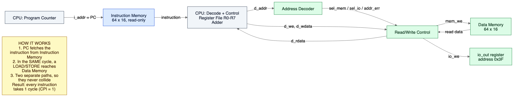
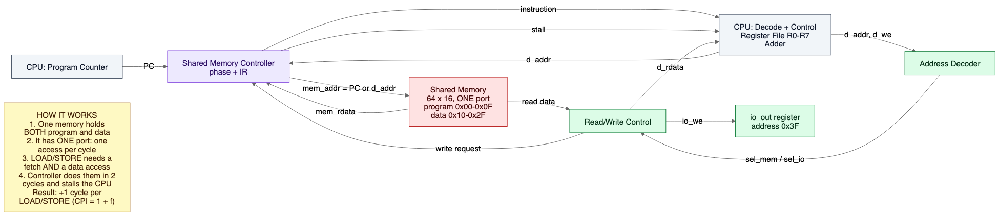
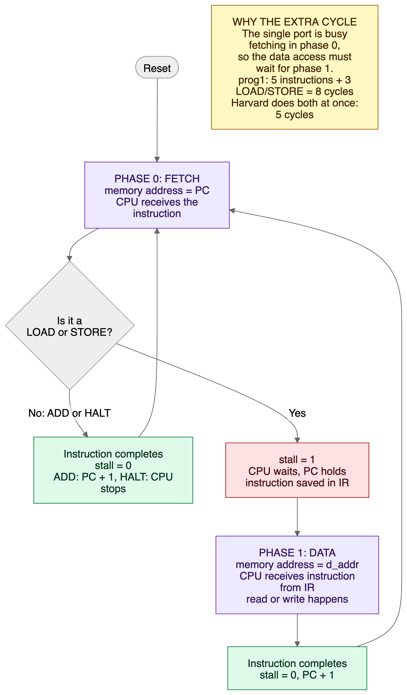

# Harvard vs. Shared Memory Architecture (von Neumann)
### Quantifying the Structural Hazard and Memory Stall Penalty in a Single-Cycle RISC CPU

[](https://en.wikipedia.org/wiki/Verilog)
[](http://iverilog.icarus.com/)
[](http://gtkwave.sourceforge.net/)
[](#system-architecture)
[](#empirical-benchmarks--verification-matrix)
[](docs/report.pdf)
[](https://drive.google.com/drive/folders/11TKyjFgnwvwtMhVrKYWLzbvaXDxLYP_N?usp=sharing)

**Project Demonstration Videos:** [Watch Videos on Google Drive](https://drive.google.com/drive/folders/11TKyjFgnwvwtMhVrKYWLzbvaXDxLYP_N?usp=sharing)

> **Semester-05 MCA Capstone Project — Project 9: Instruction and Data Memory Hierarchy**  
> **Repository:** [3ncryptor/Sem-05-MCA-Project](https://github.com/3ncryptor/Sem-05-MCA-Project)  
> **Authors:** Aryan Vibhuti, Saswataduity Bhuin, Debasish Karan, Aryu Rao, Sayan Bhattacharya  
> **Full IEEE Paper:** [`docs/report.pdf`](docs/report.pdf) | LaTeX Source: [`docs/report.tex`](docs/report.tex)

---

## Table of Contents

- [1. Executive Summary](#1-executive-summary)
- [2. The Architectural Problem](#2-the-architectural-problem)
- [3. Analytical Cycle Model & Theoretical Proof](#3-analytical-cycle-model--theoretical-proof)
- [4. System Architecture](#4-system-architecture)
  - [4.1 Harvard Architecture (`harvard_top.v`)](#41-harvard-architecture-harvard_topv)
  - [4.2 Shared Memory Architecture (`shared_top.v`)](#42-shared-memory-architecture-shared_topv)
- [5. Instruction Set Architecture (ISA) & Datapath](#5-instruction-set-architecture-isa--datapath)
  - [5.1 Instruction Word Encoding (16-bit)](#51-instruction-word-encoding-16-bit)
  - [5.2 Instruction Set Specifications](#52-instruction-set-specifications)
  - [5.3 Datapath & Single-Cycle Architectural Gating](#53-datapath--single-cycle-architectural-gating)
- [6. Memory Organization & Address Map](#6-memory-organization--address-map)
  - [6.1 Address Space Mapping](#61-address-space-mapping)
  - [6.2 Address Decoding & Glitch Suppression](#62-address-decoding--glitch-suppression)
- [7. Microarchitectural Engineering: Resolving the Combinational Loop](#7-microarchitectural-engineering-resolving-the-combinational-loop)
  - [7.1 The Combinational Feedback Hazard](#71-the-combinational-feedback-hazard)
  - [7.2 The Hardware Fix: Opcode Snooping](#72-the-hardware-fix-opcode-snooping)
  - [7.3 Two-Phase Memory Controller State Machine](#73-two-phase-memory-controller-state-machine)
- [8. Empirical Benchmarks & Verification Matrix](#8-empirical-benchmarks--verification-matrix)
  - [8.1 Test Program Workloads](#81-test-program-workloads)
  - [8.2 Quantitative Results Table](#82-quantitative-results-table)
  - [8.3 Cycle-by-Cycle Waveform Trace Analysis (`prog1`)](#83-cycle-by-cycle-waveform-trace-analysis-prog1)
  - [8.4 Verification Rigor & Fault Injection](#84-verification-rigor--fault-injection)
- [9. Quickstart: Simulation & Waveforms](#9-quickstart-simulation--waveforms)
  - [9.1 Dependencies](#91-dependencies)
  - [9.2 Simulation Commands](#92-simulation-commands)
  - [9.3 GTKWave Inspection Checklist](#93-gtkwave-inspection-checklist)
- [10. Repository Directory Structure](#10-repository-directory-structure)
- [11. Engineering Team & Subsystem Ownership](#11-engineering-team--subsystem-ownership)
- [12. License & Academic Attribution](#12-license--academic-attribution)

---

## 1. Executive Summary

Every stored-program computer must transfer two types of information across its interconnect: **executable instructions** and **data operands**. 

In textbook computer architecture, the distinction between **Harvard architecture** (physically segregated instruction and data memories) and **von Neumann / Shared Memory architecture** (a unified memory space accessed via a shared port) is frequently introduced as a qualitative concept. 

This project delivers a **rigorous, gate-level hardware implementation** in synthesizable Verilog-2001 that empirically proves and quantifies the exact structural hazard penalty of a shared memory port. 

### Key Highlights
* **Zero Processor Modifications:** The exact same core CPU module (`rtl/cpu.v`) powers both systems without changing a single line of RTL.
* **Deterministic Single-Cycle Baseline:** Because every instruction completes in $1$ cycle, memory port contention cannot hide behind multi-cycle pipelining or cache latencies.
* **Closed-Form Mathematical Validation:** We mathematically prove and empirically verify down to the individual clock cycle:
  $$T_{\text{Shared}} = T_{\text{Harvard}} + N_{\text{LS}}$$
  $$\text{CPI}_{\text{Shared}} = 1 + f$$
  where $N_{\text{LS}}$ is the number of executed `LOAD`/`STORE` instructions and $f = N_{\text{LS}}/N$ is the workload's data access fraction.
* **Hazard-Free Controller Design:** Solved a critical hardware circular dependency (combinational loop between `stall` and `d_we`) through **direct opcode snooping** in the memory controller.
* **Comprehensive Test Suite:** Self-checking automated testbenches with GTKWave `.vcd` tracing, MMIO testing, unmapped address error handling, and mutation-based fault injection.

---

## 2. The Architectural Problem

When a single-cycle processor executes a `LOAD` or `STORE` instruction, it must:
1. **Fetch** the 16-bit instruction word from address $\text{PC}$.
2. **Access** (read or write) the operand at data address $(R[rs1] + imm6) \bmod 64$.

```
Harvard System (Dual-Port Access):
Cycle t : [Port A: Fetch Instr @ PC]  ||  [Port B: Data Access @ Addr]  --> 1 Clock Cycle Total

Shared System (Single Unified Port):
Cycle t   : [Port: Fetch Instr @ PC]  (CPU Stalled! Data Access BLOCKED)
Cycle t+1 : [Port: Data Access @ Addr] (CPU Completes Instruction)       --> 2 Clock Cycles Total
```

Because a single-ported SRAM macro can only service one memory transaction per clock cycle, the single-port shared system encounters a classic **structural hazard**. To resolve it, the memory controller must insert a pipeline stall ($\text{stall} = 1$), latch the fetched instruction into an Instruction Register ($\text{IR}$), and route the memory port to the data address on the subsequent clock cycle.

---

## 3. Analytical Cycle Model & Theoretical Proof

### Definition: Execution Metrics
Let a workload execute dynamic instruction sequence $N$, terminating at `HALT`, where $N_{\text{LS}}$ is the dynamic count of `LOAD` and `STORE` instructions. The data-access fraction is:
$$f = \frac{N_{\text{LS}}}{N}, \quad f \in [0, 1)$$
The total cycle count $T$ is the number of rising clock edges from reset deassertion until the registered `halted` flag asserts (inclusive of `HALT`).

### Proposition 1 (Cycle Count Law)
For any valid instruction sequence in this ISA:
$$T_{\text{Harvard}} = N$$
$$T_{\text{Shared}} = N + N_{\text{LS}}$$

#### Formal Proof:
1. **Harvard System:** The processor's stall port is tied to ground ($\text{stall} = 0$). The execution condition $\text{run} = \overline{\text{stall}} \wedge \overline{\text{halted\_r}}$ remains asserted on every cycle prior to `HALT`. Each instruction fetches and completes in exactly $1$ cycle. Thus, $T_{\text{Harvard}} = N$.
2. **Shared System:** Reset initializes $\text{phase} = 0$. In Phase 0 (Fetch), instructions with opcodes other than `LOAD`/`STORE` (`ADD`, `HALT`) complete combinationally in that same cycle ($1$ cycle). For `LOAD` and `STORE`, the controller detects opcode $2$ or $3$, raises $\text{stall} = 1$ (nullifying datapath write enables), latches the instruction into $\text{IR}$, and transitions to $\text{phase} = 1$. In Phase 1 (Data), $\text{stall} = 0$, the CPU completes execution from $\text{IR}$, and $\text{phase}$ returns to $0$ on the next edge ($2$ cycles total).
3. Summing total cycles:
   $$T_{\text{Shared}} = (N - N_{\text{LS}}) \times 1 + N_{\text{LS}} \times 2 = N + N_{\text{LS}} = T_{\text{Harvard}} + N_{\text{LS}} \quad \blacksquare$$

### Corollary: Throughput Bound & CPI
$$\text{CPI}_{\text{Harvard}} = 1.0, \qquad \text{CPI}_{\text{Shared}} = 1 + f$$
$$\text{Speedup } S = \frac{T_{\text{Shared}}}{T_{\text{Harvard}}} = 1 + f$$

Because a single port can deliver at most $1$ word per cycle while a program demands $1 + f$ transfers per instruction, the shared system is bounded by:
$$\text{IPC}_{\text{Shared}} \le \frac{1}{1 + f}$$
Our two-phase controller saturates this theoretical limit with **100% port efficiency**, meeting the upper bound with exact equality.

---

## 4. System Architecture

Both top-level designs instantiate the identical synthesizable core `rtl/cpu.v`.

```
========================================================================================
                                 HARVARD ARCHITECTURE
========================================================================================
             +--------------------------------------------------------+
             |                         CPU                            |
             |  +------------------+           +-------------------+  |
             |  | Program Counter  |           |   Register File   |  |
             |  |      (PC)        |           |   (R0 - R7, 16b)  |  |
             |  +--------+---------+           +---------+---------+  |
             +-----------|-------------------------------|------------+
                         | i_addr (6b)                   | d_addr (6b), d_wdata, d_re, d_we
                         v                               v
             +-----------------------+         +----------------------+
             |  Instruction Memory   |         |   Address Decoder    |
             |      (64 x 16b)       |         |   + Read/Write Mux   |
             |      Read-Only        |         +----------+-----------+
             +-----------+-----------+                    |
                         | i_data (16b)                   v
                         |                     +----------------------+
                         +-------------------->|     Data Memory      |
                           (Simultaneous       |  (64 x 16b) + MMIO   |
                            Single-Cycle)      +----------------------+

========================================================================================
                            SHARED (von NEUMANN) ARCHITECTURE
========================================================================================
             +--------------------------------------------------------+
             |                         CPU                            |
             |  +------------------+           +-------------------+  |
             |  | Program Counter  |           |   Register File   |  |
             |  |      (PC)        |           |   (R0 - R7, 16b)  |  |
             |  +--------+---------+           +---------+---------+  |
             +-----------|-------------------------------|------------+
            i_addr (6b)  |                               | d_addr (6b), d_wdata, d_re, d_we
                         v                               v
                     +---------------------------------------+
      stall <--------|     Shared Memory Port Controller     |<------- phase
     i_data <--------|          (Phase FSM + IR)             |
                     +-------------------+-------------------+
                                         | mem_addr (6b), mem_we, mem_wdata
                                         v
                             +-----------------------+
                             |     Shared Memory     |
                             |      (64 x 16b)       |
                             |   [Code: 0x00-0x0F]   |
                             |   [Data: 0x10-0x2F]   |
                             |   [MMIO: 0x3F]        |
                             +-----------------------+
```

### 4.1 Harvard Architecture (`harvard_top.v`)
* **Dedicated Paths:** The program counter drives `instruction_memory` directly; data accesses route through the address decoder to `data_memory` and `io_reg`.
* **Zero Structural Stalls:** `stall` is hardwired to `1'b0`.
* **Hardware Code Security:** The instruction memory module possesses **no write port** at the physical RTL interface, guaranteeing code integrity against arbitrary rogue pointers.



### 4.2 Shared Memory Architecture (`shared_top.v`)
* **Single Physical Port:** Unified $64 \times 16$ SRAM storing machine code at `0x00`–`0x0F` and data at `0x10`–`0x2F`.
* **Controller Arbitration:** The `shared_mem_controller` time-multiplexes the bus between PC (fetch) and data addresses.
* **Code Mutability Vulnerability:** Unlike Harvard, a store instruction targeted to `0x00`–`0x0F` can structurally overwrite program instructions in RAM.



---

## 5. Instruction Set Architecture (ISA) & Datapath

The CPU executes a custom 16-bit word-oriented RISC instruction set optimized for clarity and signal observability.

### 5.1 Instruction Word Encoding (16-bit)

```
       15    12 11     9 8     6 5                    0
      +--------+--------+-------+----------------------+
HALT  |  0000  |  000   |  000  |        000000        |
      +--------+--------+-------+----------------------+
ADD   |  0001  |   rd   |  rs1  |  rs2  |    000       |
      +--------+--------+-------+-------+--------------+
LOAD  |  0010  |   rd   |  rs1  |      imm6 offset     |
      +--------+--------+-------+----------------------+
STORE |  0011  |  rs2*  |  rs1  |      imm6 offset     |
      +--------+--------+-------+----------------------+
       * For STORE, bits [11:9] specify the value source register rs2.
```

### 5.2 Instruction Set Specifications

| Opcode | Mnemonic | Format | RTL Semantics | Description |
| :---: | :--- | :--- | :--- | :--- |
| `0000` | **HALT** | `HALT` | `halted_r <= 1; PC <= PC` | Freezes PC, prevents state updates, signals completion |
| `0001` | **ADD** | `ADD rd, rs1, rs2` | $R[rd] \leftarrow R[rs1] + R[rs2]$ | 16-bit two's-complement arithmetic addition |
| `0010` | **LOAD** | `LOAD rd, [rs1+imm6]` | $R[rd] \leftarrow M[(R[rs1] + imm6) \bmod 64]$ | Loads memory word into destination register |
| `0011` | **STORE**| `STORE rs2, [rs1+imm6]`| $M[(R[rs1] + imm6) \bmod 64] \leftarrow R[rs2]$ | Stores source register into memory word |
| `0100`..`1111` | *Reserved* | — | *Treated as HALT* | Safe failure trap (guarantees zero-padded RAM halts) |

* **Register File:** Eight 16-bit registers (`R0` through `R7`). `R0` is hardwired to `16'h0000` (writes to `R0` are discarded).
* **Common Address Generation:** Both `LOAD` and `STORE` share the base register in `[8:6]` and the immediate in `[5:0]`, utilizing a shared adder:
  $$\text{Target Address} = (R[rs1] + imm6) \bmod 64$$

### 5.3 Datapath & Single-Cycle Architectural Gating

Architectural state is gated globally in `rtl/cpu.v` by the single control signal `run`:

```verilog
wire run = ~stall & ~halted_r;

// Register file write enable
.we(run & (is_add | is_load))

// Program counter step enable
.en(run & ~is_halt)

// Data memory write enable
assign d_we = is_store & run;
```

When `stall = 1`, all state updates are suppressed: the PC holds its current value, register files reject writes, and memory writes are disabled. The same instruction is re-presented to the datapath on the next clock cycle.

---

## 6. Memory Organization & Address Map

Both systems share a unified 6-bit word-addressable memory map ($2^6 = 64$ addressable 16-bit words):

### 6.1 Address Space Mapping

| Hex Range | Word Range | Physical Target | Access Permissions | Behavior / Notes |
| :--- | :--- | :--- | :--- | :--- |
| `0x00` – `0x0F` | 0 – 15 | Program Space | Read-Only (Harvard) / RW (Shared) | Stores machine code instructions |
| `0x10` – `0x2F` | 16 – 47 | Data Space | Read / Write | General data storage and operands |
| `0x30` – `0x3E` | 48 – 62 | Unmapped | None | Asserts `addr_err = 1`; write ignored; read returns `0` |
| `0x3F` | 63 | MMIO Output Reg | Read / Write | Memory-mapped I/O port (`io_out`) |

### 6.2 Address Decoding & Glitch Suppression

Because instruction bit fields drive the `d_addr` lines continuously (even during `ADD` or `HALT`), a naive address decoder would trigger spurious error flags.

`rtl/address_decoder.v` solves this by strictly qualifying address evaluation with an active access strobe:
* **Harvard Access Strobe:** `access = d_re | d_we`
* **Shared Memory Access Strobe:** `access = phase & (d_re | d_we)`

```verilog
wire in_mem = (addr <= 6'h2F);
wire in_io  = (addr == 6'h3F);

assign sel_mem  = in_mem;
assign sel_io   = in_io;
assign addr_err = access & ~in_mem & ~in_io;
```

This ensures `addr_err` asserts **only** when an active `LOAD` or `STORE` targets an illegal physical address (verified in `prog2`).

---

## 7. Microarchitectural Engineering: Resolving the Combinational Loop

A critical engineering challenge in building the shared-memory controller is avoiding asynchronous combinational feedback loops.

### 7.1 The Combinational Feedback Hazard

An intuitive design for the shared memory controller would assert `stall` whenever the CPU requests a memory operation:
$$\text{stall} = \overline{\text{phase}} \wedge (d\_re \vee d\_we)$$

However, examining `rtl/cpu.v` reveals:
$$d\_we = \text{is\_store} \wedge \text{run} = \text{is\_store} \wedge (\overline{\text{stall}} \wedge \overline{\text{halted\_r}})$$

Substituting $d\_we$ into the stall equation results in a fatal **combinational loop**:
$$\text{stall} \propto d\_we \propto \overline{\text{stall}}$$

During a `STORE`, asserting `stall = 1` immediately forces `run = 0`, which drops $d\_we = 0$, which in turn drops $\text{stall} = 0$, causing continuous high-frequency combinational oscillation within a single cycle.

### 7.2 The Hardware Fix: Opcode Snooping

The `shared_mem_controller` eliminates this loop entirely by deriving the stall condition directly from the **memory bus output word** (`mem_rdata`), which is purely registered with respect to CPU outputs:

```verilog
// rtl/shared_mem_controller.v
wire [3:0] fetched_op = mem_rdata[15:12];
wire       is_mem_op  = (fetched_op == 4'd2) || (fetched_op == 4'd3); // LOAD or STORE

assign stall    = ~phase & is_mem_op;
assign instr    = phase ? IR     : mem_rdata;
assign mem_addr = phase ? d_addr : pc;
assign mem_we   = phase & data_we;
```

Because `fetched_op` is driven exclusively by SRAM read data and the registered `phase` bit, the combinational feedback path is completely broken while preserving identical timing behavior.

### 7.3 Two-Phase Memory Controller State Machine



```
              +-----------------------------+
              |    RESET / PHASE 0 (Fetch)   |
              |   mem_addr = PC             |
              |   instr    = mem_rdata      |
              +--------------+--------------+
                             |
             +---------------+---------------+
             |                               |
       Opcode is ADD/HALT             Opcode is LOAD/STORE
             |                               |
             v                               v
      +--------------+              +-----------------+
      | stall = 0    |              | stall = 1       |
      | Retires in   |              | IR <= mem_rdata |
      | 1 cycle      |              | phase <= 1      |
      +--------------+              +--------+--------+
                                             |
                                             v
                              +-----------------------------+
                              |       PHASE 1 (Data)        |
                              |   mem_addr = d_addr         |
                              |   instr    = IR (latched)   |
                              |   mem_we   = data_we        |
                              |   stall    = 0              |
                              |   phase   <= 0              |
                              +-----------------------------+
```

---

## 8. Empirical Benchmarks & Verification Matrix

The repository contains three comprehensive assembly workloads designed to validate functional correctness, structural hazard penalties, and exception handling.

### 8.1 Test Program Workloads

#### 1. `prog1` (Reference Memory & Compute Benchmark)
Computes $R3 = M[0x10] + M[0x11]$ ($5 + 7 = 12$) and writes the result back to $M[0x20]$.
```assembly
// Machine Code: 2210 2411 1650 3620 0000
0x00: LOAD  R1, [R0 + 0x10]    // Load 5 into R1
0x01: LOAD  R2, [R0 + 0x11]    // Load 7 into R2
0x02: ADD   R3, R1, R2         // Compute 5 + 7 = 12 into R3
0x03: STORE R3, [R0 + 0x20]    // Store 12 into MEM[0x20]
0x04: HALT                     // Terminate
```
*Checked properties:* $R1 = 5$, $R2 = 7$, $R3 = 12$, $M[0x20] = 12$.

#### 2. `prog2` (Address Decoding & MMIO Benchmark)
Tests memory-mapped I/O and unmapped address trap detection.
```assembly
// Machine Code: 2210 323F 3230 0000
0x00: LOAD  R1, [R0 + 0x10]    // Load 5 into R1
0x01: STORE R1, [R0 + 0x3F]    // Store 5 to MMIO register (io_out)
0x02: STORE R1, [R0 + 0x30]    // Store to unmapped address -> triggers addr_err = 1
0x03: HALT                     // Terminate
```
*Checked properties:* `io_out` $= 5$, `addr_err` asserts, data memory remains pristine.

#### 3. `prog3` (Pure ALU Control Benchmark)
Performs back-to-back additions with zero memory transactions ($f = 0$).
```assembly
// Machine Code: 1200 1448 1690 0000
0x00: ADD R1, R0, R0           // R1 = 0 + 0 = 0
0x01: ADD R2, R1, R1           // R2 = 0 + 0 = 0
0x02: ADD R3, R2, R2           // R3 = 0 + 0 = 0
0x03: HALT                     // Terminate
```
*Checked properties:* $R1 = R2 = R3 = 0$, exactly zero memory stalls in both architectures.

---

### 8.2 Quantitative Results Table

Every test configuration was executed via Icarus Verilog 13.0. Measured cycle counts match theoretical predictions with zero error.

| Benchmark | Total Inst ($N$) | Mem Ops ($N_{\text{LS}}$) | Data Frac ($f$) | Harvard Cycles | Shared Cycles (Meas / Model) | Penalty ($\Delta T$) | Harvard Speedup ($S$) | Verification Status |
| :--- | :---: | :---: | :---: | :---: | :---: | :---: | :---: | :---: |
| **`prog1`** | 5 | 3 | 0.60 | **5** | **8 / 8** | +3 cycles | **1.60×** | `PASS` |
| **`prog2`** | 4 | 3 | 0.75 | **4** | **7 / 7** | +3 cycles | **1.75×** | `PASS` |
| **`prog3`** | 4 | 0 | 0.00 | **4** | **4 / 4** | +0 cycles | **1.00×** | `PASS` |

```
Execution Cycles Comparison:
===================================================================
prog1 (Compute + Memory):
  Harvard : [C0][C1][C2][C3][C4] (5 cycles)
  Shared  : [C0:F][C1:D][C2:F][C3:D][C4:ADD][C5:F][C6:D][C7:HALT] (8 cycles) -> +3 Stalls

prog2 (MMIO + Unmapped Address):
  Harvard : [C0][C1][C2][C3] (4 cycles)
  Shared  : [C0:F][C1:D][C2:F][C3:D][C4:F][C5:D][C6:HALT] (7 cycles) -> +3 Stalls

prog3 (ALU Control - Zero Memory Access):
  Harvard : [C0][C1][C2][C3] (4 cycles)
  Shared  : [C0][C1][C2][C3] (4 cycles) -> 0 Stalls (Exact Parity)
===================================================================
```

---

### 8.3 Cycle-by-Cycle Waveform Trace Analysis (`prog1`)

Instrumenting the hardware top-level modules produces the exact address bus allocation trace:

| Cycle | Harvard `i_addr` | Harvard `d_addr` | Harvard Event | Shared `mem_addr` | Shared `phase` | Shared `stall` | Shared Microarchitectural Event |
| :---: | :---: | :---: | :--- | :---: | :---: | :---: | :--- |
| **0** | `0x00` | `0x10` | Fetch & Load `MEM[0x10]` | `0x00` | 0 | 1 | Fetch `LOAD`; port busy; latch `IR`; CPU stalls |
| **1** | `0x01` | `0x11` | Fetch & Load `MEM[0x11]` | `0x10` | 1 | 0 | Access operand `MEM[0x10]`; $R1 \leftarrow 5$ |
| **2** | `0x02` | — | Fetch & Execute `ADD` | `0x01` | 0 | 1 | Fetch `LOAD`; port busy; latch `IR`; CPU stalls |
| **3** | `0x03` | `0x20` | Fetch & Store `MEM[0x20]` | `0x11` | 1 | 0 | Access operand `MEM[0x11]`; $R2 \leftarrow 7$ |
| **4** | `0x04` | — | Fetch & Execute `HALT` | `0x02` | 0 | 0 | Fetch & Execute `ADD`; $R3 \leftarrow 12$ |
| **5** | — | — | *Halted* | `0x03` | 0 | 1 | Fetch `STORE`; port busy; latch `IR`; CPU stalls |
| **6** | — | — | *Halted* | `0x20` | 1 | 0 | Write operand `MEM[0x20] <= 12` |
| **7** | — | — | *Halted* | `0x04` | 0 | 0 | Fetch & Execute `HALT`; system stops |

---

### 8.4 Verification Rigor & Fault Injection

To ensure that the testbenches were not returning "false passes" due to trivial or missing assertions:
* **ALU Mutation Test:** We intentionally modified `rtl/cpu.v`, swapping the adder (`rdata1 + rdata2`) with a subtractor (`rdata1 - rdata2`). Running `make compare` immediately failed on `prog1`:
  ```
  FAIL R3: got 65534, expected 12
  ```
* **Memory Protection Verification:** Confirmed via `prog2` assertions that invalid stores to `0x30` leave RAM contents unmodified and assert `addr_err = 1`.

---

## 9. Quickstart: Simulation & Waveforms

### 9.1 Dependencies

Install the open-source EDA simulation suite:

* **macOS (Homebrew):**
  ```sh
  brew install icarus-verilog gtkwave
  ```
* **Ubuntu / Debian:**
  ```sh
  sudo apt-get update && sudo apt-get install -y iverilog gtkwave
  ```

### 9.2 Simulation Commands

The project includes a robust, fully automated `Makefile`:

```sh
# Run one program on Harvard architecture (PROG=prog1, prog2, or prog3)
make harvard PROG=prog1

# Run one program on Shared Memory (von Neumann) architecture
make shared PROG=prog1

# Run the complete automated comparative verification suite (all programs x both architectures)
make compare

# Delete generated simulation artifacts (.vvp, .vcd, results)
make clean
```

#### Expected `make compare` Output:
```
| Program | LOAD/STORE | Harvard cycles | Shared cycles | Extra |
|---|---|---|---|---|
| prog1 | 3 | 5 | 8 | 3 |
| prog2 | 3 | 4 | 7 | 3 |
| prog3 | 0 | 4 | 4 | 0 |
```

---

### 9.3 GTKWave Inspection Checklist

To inspect the hardware waveforms generated in `sim/`:

```sh
gtkwave sim/harvard_prog1.vcd
gtkwave sim/shared_prog1.vcd
```

#### Key Signals to Monitor:

| Scope | Signal Name | What to Observe |
| :--- | :--- | :--- |
| `tb_*.dut` | `clk`, `rst` | 100 MHz clock (10 ns period), active-high synchronous reset |
| `tb_*.dut.u_cpu` | `i_addr`, `i_data` | Instruction fetch bus: Program counter and instruction word |
| `tb_*.dut.u_cpu` | `d_addr`, `d_wdata`, `d_rdata` | Data memory operand bus |
| `tb_shared.dut` | `stall` | Asserts high (`1'b1`) during Phase 0 for every `LOAD`/`STORE` |
| `tb_shared.dut` | `phase` | Toggles `0 -> 1` to arbitrate fetch vs data cycles |
| `tb_shared.dut` | `mem_addr` | Single shared memory address bus multiplexed between PC and data |
| `tb_*.dut.u_cpu.u_rf`| `r1`, `r2`, `r3` | Register state transitions (e.g., $5, 7, 12$ in `prog1`) |
| `tb_*.dut` | `addr_err` | Pulses high for unmapped accesses (Cycle 5 of `prog2`) |
| `tb_*.dut` | `halted` | Asserts atomically on `HALT`, freezing all CPU state |

---

## 10. Repository Directory Structure

```
.
├── Makefile                      # Automated simulation, compilation, and comparison targets
├── README.md                     # Comprehensive technical documentation & project guide
├── docs/
│   ├── decisions.md              # Engineering design rationale & microarchitectural decisions
│   ├── report.pdf                # Published IEEE conference paper (compiled)
│   ├── report.tex                # Complete LaTeX source with embedded TikZ diagrams
│   └── diagrams/
│       ├── harvard-system.png    # Harvard architecture detailed block diagram
│       ├── shared-memory-system.png # Shared memory architecture block diagram
│       └── shared-controller-flow.png # Two-phase memory controller FSM flowchart
├── programs/                     # Test programs & initial memory hex images
│   ├── prog1.hex                 # prog1: Compute & memory benchmark instructions
│   ├── prog1_data.hex            # prog1: Initial data memory array (0x10=5, 0x11=7)
│   ├── prog2.hex                 # prog2: MMIO and unmapped address trap instructions
│   ├── prog2_data.hex            # prog2: Initial data memory array
│   ├── prog3.hex                 # prog3: Pure ALU arithmetic control instructions
│   └── prog3_data.hex            # prog3: Initial data memory array
├── rtl/                          # Synthesizable Verilog-2001 RTL Source Files
│   ├── address_decoder.v         # Combinational 6-bit address decoder with access gating
│   ├── cpu.v                     # 16-bit single-cycle processor core with stall interface
│   ├── data_memory.v             # Harvard 64x16 data SRAM macro
│   ├── harvard_top.v             # Top-level module: Harvard architecture integration
│   ├── instruction_memory.v      # Harvard 64x16 read-only instruction memory
│   ├── io_reg.v                  # Memory-mapped I/O output register (0x3F)
│   ├── program_counter.v         # 6-bit program counter with synchronous enable
│   ├── register_file.v           # 8x16-bit register file (R0 tied to 0, wave inspection taps)
│   ├── rw_control.v              # Read/write steering and memory output multiplexer
│   ├── shared_mem_controller.v   # Two-phase port arbitrator and opcode-snooping FSM
│   ├── shared_memory.v           # Unified 64x16 single-ported SRAM macro
│   └── shared_top.v              # Top-level module: Shared von Neumann integration
├── tb/                           # Self-Checking Automated Testbenches
│   ├── tb_harvard.v              # Harvard system testbench with metric counters & assertion checks
│   └── tb_shared.v               # Shared system testbench with metric counters & assertion checks
└── sim/                          # Simulation outputs (generated dynamically, git-ignored)
    ├── harvard_prog1.vcd         # GTKWave execution waveforms
    └── results.txt               # Verification output logs
```

---

## 11. Engineering Team & Subsystem Ownership

| Engineer | Primary Responsibilities & RTL Module Ownership |
| :--- | :--- |
| **Aryan Vibhuti** | **Datapath Registers & Program Control:** Designed and verified the 8-entry general-purpose register file (`register_file.v`) with hardwired zero-register $R0$, probe wires for VCD waveform dumping, and the program counter (`program_counter.v`). |
| **Saswataduity Bhuin** | **Processor Core & Control Logic:** Designed the complete 16-bit single-cycle CPU (`cpu.v`), including opcode decoding, ALU adder integration, load/store address calculation, stall-gated execution control, and atomic `halted` register semantics. |
| **Debasish Karan** | **Memory Interconnect & MMIO:** Implemented the combinational address space decoder (`address_decoder.v`), read/write signal multiplexing (`rw_control.v`), memory-mapped I/O register (`io_reg.v`), and spurious-glitch suppression. |
| **Aryu Rao** | **Harvard Architecture & Toolchain:** Implemented Harvard top-level integration (`harvard_top.v`), instruction and data memories (`instruction_memory.v`, `data_memory.v`), test programs (`programs/`), testbench (`tb_harvard.v`), build system (`Makefile`), and IEEE paper. |
| **Sayan Bhattacharya** | **Shared Memory & Hazard Controller:** Designed the unified memory macro (`shared_memory.v`), the two-phase structural hazard controller (`shared_mem_controller.v`), shared top-level integration (`shared_top.v`), and shared testbench (`tb_shared.v`). |

---

## 12. License & Academic Attribution

This project was developed as part of the MCA Semester-5 Computer Architecture curriculum. The code and documentation are released under the [MIT License](https://opensource.org/licenses/MIT).

If you reference this work in your research, academic courses, or hardware designs, please cite:

```bibtex
@inproceedings{project9_harvard_vs_shared,
  author    = {Aryan Vibhuti and Saswataduity Bhuin and Debasish Karan and Aryu Rao and Sayan Bhattacharya},
  title     = {Quantifying the Stall Penalty of a Shared Memory Port in a Single-Cycle CPU},
  booktitle = {Semester-05 MCA Computer Architecture Capstone Proceedings},
  year      = {2026},
  url       = {https://github.com/3ncryptor/Sem-05-MCA-Project}
}
```
